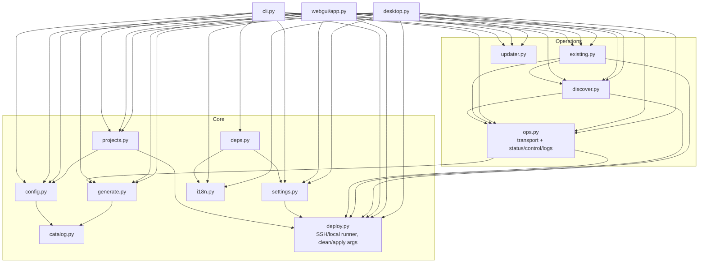
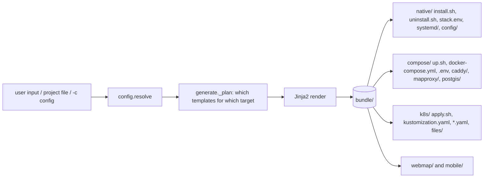
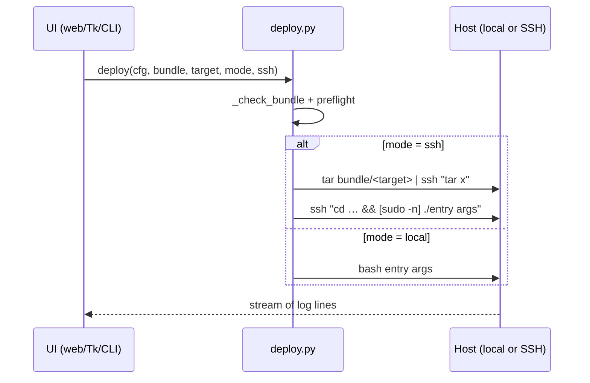
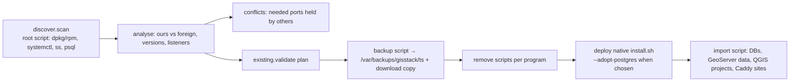
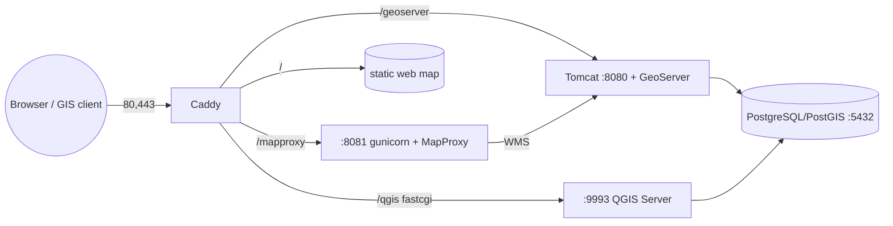
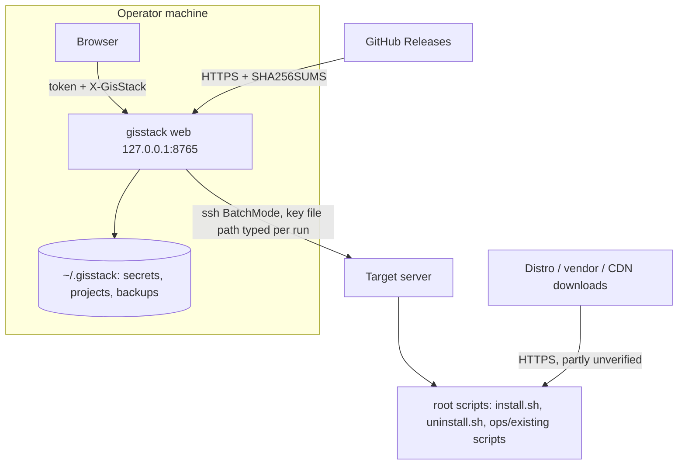

# GIS-STACK — Architecture (current state)

*Describes the code at the audited revision (package 0.1.2 + the work released as 0.1.3). This document is descriptive: it records how the system works today. Proposed changes live in [ROADMAP.md](ROADMAP.md); problems are catalogued in [TECHNICAL_AUDIT.md](TECHNICAL_AUDIT.md).*

## 1. What the system is

GIS-STACK is a **generator + operator** for a GIS server stack. From one configuration it renders deployment files (a *bundle*) for three targets and can run, inspect, update, back up and remove the result, locally or over SSH.

| Layer | Responsibility |
|---|---|
| Interfaces | Web GUI (Flask + one HTML page), desktop GUI (Tkinter), CLI (`gisstack …`) |
| Domain modules | configuration, catalog, generation, deployment, operations (status/control/logs), discovery of existing programs, existing-program actions, projects, updater, settings, i18n |
| Templates | Jinja2 files that become shell scripts, systemd units, Compose/K8s YAML, Caddyfile, MapProxy config, web map and mobile templates |
| Target systems | A Linux host (native packages + systemd), a container runtime (Compose), or a Kubernetes cluster |

## 2. Modules and dependencies



| Module | Lines | Role | Notable properties |
|---|---|---|---|
| `config.py` | 240 | `default_config()`, `resolve()` (merge, validate, apply dependencies, fill secrets), persisted generated secrets | Validates a subset of fields; unknown keys are kept |
| `catalog.py` | 207 | Components, extensions, versions, grids, TLS modes, targets, UI catalog | Single source for what can be selected; includes Georgian labels |
| `generate.py` | 347 | File plan per target, Jinja2 environment, bundle writer, zip | `autoescape=False`; `shq` filter exists |
| `deploy.py` | 213 | Run a bundle entry point locally or over SSH (tar over ssh), argument builders for `clean`/`apply`, `home_dir()` | No timeout/cancel in `_stream` |
| `ops.py` | 627 | Transport (`_argv`, `_run`, `_stream`), status parsers for native/compose/k8s, control/log script builders, console table | Transport is private but used by other modules |
| `discover.py` | 346 | One root script collects facts about installed programs; `parse` → `analyse` → `conflicts` | Pure parsers, covered by tests |
| `existing.py` | 386 | Plan model (`ignore/adopt/remove/reuse/disable`), backup/remove/import scripts, orchestration `run()` | Native target only |
| `projects.py` | 108 | Saved projects `~/.gisstack/projects/<name>.json`, per-program sections | |
| `updater.py` | 196 | GitHub release check, SHA-256 verified download, venv upgrade | |
| `settings.py`, `i18n.py`, `deps.py` | 61 / 476 / 93 | Language/theme settings, Georgian→English table and `tr()`, consent-based Tkinter install | |
| `cli.py` | 422 | argparse front-end; thin wrappers around the modules above | 0 % tested |
| `webgui/app.py` | 475 | Flask app factory, authentication, 24 routes, in-memory jobs | Dev server |
| `desktop.py` | 1,110 | Tkinter GUI, theme, translation shim | Patches `ttk`/`tk.Wm` at import |

## 3. Configuration model

`resolve()` turns user input into a *resolved config* (a plain nested `dict`):

```
project, domain, email, tls, targets[], deploy_target, runtime
components{postgis,tomcat,geoserver,qgis_server,mapproxy,caddy,webmap,mobile_templates}
postgres{version,db,user,password,extensions[],ram_gb,max_connections,remote_access,allowed_cidr,port}
tomcat{major,heap_mb,port,manager_password}   geoserver{channel,version,image,heap_mb,admin_*,extensions[]}
qgis{projects_dir,processes}   mapproxy{grids[],cache_type,format,workers,layers[],seed{…},…}
webmap{title_ka,title_en,default_lang,center,zoom,basemap,…}   k8s{namespace,storage_class,*_image,service_type}
```

Rules applied by `resolve()` include: GeoServer channel dictates Tomcat major/Java; native GeoServer pulls in Tomcat; WebMercator grid is forced when the web map is on; generated secrets are persisted per project (`~/.gisstack/secrets/<project>.json`, `0600`) and reused. There is **no schema version** and no rejection of unknown keys (see audit S-01, R-06).

User-visible persisted state:

| Location | Content | Mode |
|---|---|---|
| `~/.gisstack/projects/<name>.json` | saved settings (may contain typed passwords) | 0600 |
| `~/.gisstack/secrets/<name>.json` | generated secrets | 0600 |
| `~/.gisstack/settings.json` | language, theme | 0600 |
| `~/.gisstack/web.token` | web GUI token | 0600 |
| `~/.gisstack/bundles/<project>-…/` | rendered bundles (contain secrets) | 0700 (web) / default (CLI) |
| `~/.gisstack/backups/<host>/<ts>.tar.gz` | downloaded backups | 0600 |
| server `/etc/gisstack/` | `stack.env`, `credentials.txt`, imported files | 0600 / 0755 dir |
| server `/var/lib/gisstack/` | GeoServer data dir, MapProxy cache | service users |
| server `/var/backups/gisstack/<ts>/` | backup before removal | 0700 |
| server `~/gisstack-<project>/` | uploaded bundle (SSH mode) | as generated |

## 4. Generation pipeline



The bundle is self-contained: it can be copied to a server and run without GIS-STACK installed. `native/install.sh` is idempotent and accepts `--only/--skip/--list/--adopt-postgres`; `uninstall.sh` supports `--only/--purge/--remove-postgres`; `up.sh` and `apply.sh` expose `up/down/only/clean/…`.

## 5. Execution paths

### 5.1 Deploy / apply / clean



`clean_args`/`apply_args` translate a request into entry-script arguments (`--only`, `clean`, `only`, …) per target.

### 5.2 Operations (status / control / logs)

`ops.py` sends **one `bash -c` script** per request through `_argv/_run/_stream` (local, or `ssh … "sudo -n bash -c <quoted script>"`):

- *native*: `systemctl show`, `ss -Hltn`, `curl`/`/dev/tcp` probes → `parse_native` → rows;
- *compose*: `<runtime> compose -p <project> ps --format json` + `inspect` → `parse_compose`;
- *kubernetes*: `kubectl -n <ns> get pods,svc,deploy,sts -o json` → `parse_k8s`.

Control actions build per-target scripts (`systemctl …`, `compose start/stop/restart`, `kubectl scale/rollout`). Logs stream `journalctl`/`compose logs`/`kubectl logs`; follow-mode jobs accept cancellation through an `Event`.

### 5.3 Existing programs



### 5.4 Web request handling

`before_request` guard → token (cookie or `Authorization: Bearer`) with constant-time compare → CSRF header for non-GET → handler. Long operations run in a background thread registered in `JOBS` (an in-memory dict); the page polls `/api/jobs/<id>?since=N`. A process-wide `DEPLOY_LOCK` serialises deploy/clean/apply/existing/control jobs; log-follow jobs bypass it and can be cancelled.

### 5.5 Presentation concerns

- **i18n**: Georgian is the source language; `i18n.EN` maps Georgian → English; `tr()` translates whole strings and, failing that, fragments on Georgian word boundaries. The web page translates the DOM in the browser (MutationObserver, `/api/i18n`); Tk wraps widget constructors. A unit test fails when a Georgian UI string has no translation.
- **Theme and settings**: shared `settings.json`; web uses CSS variables and `html[data-theme]`; Tk uses `ttk` *clam* with a palette.

## 6. Runtime topologies

Ports below are the defaults; `postgres.port` and `tomcat.port` are configurable.



| Target | Process model |
|---|---|
| **native** | systemd units: `postgresql`, `gisstack-tomcat`, `gisstack-qgis.socket` + `.service` (systemd passes the FastCGI socket; wrapper starts N workers), `gisstack-mapproxy`, `caddy`; backends bind `127.0.0.1` when Caddy is on; only Caddy is public |
| **compose** | project `<project>`: services `postgis`, `geoserver`, optional `tomcat`, `qgis`, `mapproxy`, `caddy`; named volumes `pgdata`, `geoserver_data`, `mapproxy_cache`, `caddy_data/config`; web map is a bind mount into Caddy |
| **kubernetes** | kustomization: namespace, secret, `postgis` StatefulSet (volumeClaimTemplate), Deployments `geoserver`, `mapproxy`, `caddy`, optional `tomcat`, `qgis`; ConfigMaps for configs; PVCs; `caddy` Service (LoadBalancer by default) |

## 7. Trust boundaries and security model (as implemented)



Assumptions: the operator machine is trusted; the web GUI is reached only locally or through an SSH tunnel; configuration authored by the operator is trusted (this assumption is **not enforced** — see S-01); the target server is administered with root-equivalent privileges by design.

## 8. Extension points today

There is no plugin API. Practical extension is by editing: `catalog.py` (new component/extension/version), `generate._plan` + templates (new files), `ops` (status/control for a new service), `i18n.py` (strings). The roadmap's *Provider* and *Service* interfaces formalise these seams.

## 9. Conventions

Georgian is the source language for UI strings; every new string must be added to `i18n.EN` (enforced by a test). Remote scripts receive only regex-validated names (`_NAME`, `_UNIT`, `_DB`) and `shlex.quote`d values. Generated secret files are `0600`. All behaviour changes ship with tests; releases are cut from tags by `release.yml`.
